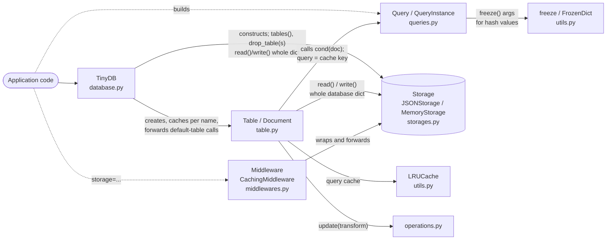

# TinyDB architecture

TinyDB is a small, document-oriented database written in pure Python with no
runtime dependencies (`pyproject.toml` declares none). A database is a set of
named **tables**, and each table holds **documents**, which are plain `dict`s
identified by an integer document ID. The whole database lives in one nested
dict that a pluggable **storage** loads and saves in one piece:

```text
{ "<table name>": { "<doc_id as str>": { ...document... }, ... }, ... }
```

This document covers the `tinydb/` package: what its components do, the main
design decisions behind it, and the rules a change should not break.

## 1. Components

| # | Component | File | Responsibility |
|---|-----------|------|----------------|
| 1 | **TinyDB** (database) | `database.py` | Entry point. `TinyDB(*args, storage=StorageClass, **kwargs)` creates the storage by calling `storage(*args, **kwargs)`, so every argument except `storage` goes to the storage. The default is `JSONStorage`. Keeps a registry `self._tables` with **one cached `Table` object per name**, created on first use by `table(name)`. Manages the set of tables (`tables()`, `drop_table()`, `drop_tables()`) by reading and writing the whole database dict through the storage. Dropping a table also discards its cached `Table` object. Forwards unknown attributes, plus `len()` and iteration, to the default table `'_default'`, which is why `db.insert(...)` works. Closes the storage on `close()` or on leaving a `with` block. |
| 2 | **Table** and **Document** | `table.py` | All document operations: insert, search, get, update, upsert, remove, truncate, count. Assigns document IDs (the largest existing ID + 1, starting at 1; the next ID is remembered in `_next_id`). Converts IDs between `str` (in storage) and `document_id_class` (`int`). Keeps a per-table **query cache**, an `LRUCache` with 10 entries by default, that maps a query object to its result list. Returns results as `Document` objects: `dict` subclasses with a `doc_id` attribute. |
| 3 | **Query** | `queries.py` | Builds queries. `Query()` records a field path through attribute or item access (`Query().a.b`, `Query()['a']`). Test methods (`==`, `<`, `exists`, `matches`, `search`, `test`, `any`, `all`, `one_of`, `fragment`, `noop`) turn the path into a `QueryInstance`: a callable `doc -> bool` with a **hash value** that identifies the query. Instances combine with `&`, `|` and `~`. `map(fn)` adds a function to the path. |
| 4 | **Storages** | `storages.py` | Persist the database dict. `Storage` is the abstract base class with `read()`, `write(data)` and an optional `close()`. `JSONStorage` keeps one file handle open for its whole lifetime. It passes extra keyword arguments to `json.dumps` and accepts `create_dirs`, `encoding` and `access_mode` (default `'r+'`; it warns for modes other than `r`, `rb`, `r+`, `rb+`). `MemoryStorage` keeps the dict in memory. |
| 5 | **Middlewares** | `middlewares.py` | Wrap a storage to change how reads and writes behave without changing the storage or TinyDB: `TinyDB(path, storage=CachingMiddleware(JSONStorage))`. `CachingMiddleware` serves reads from memory and writes to the wrapped storage only every `WRITE_CACHE_SIZE` (1000) writes, or on `flush()` / `close()`. |
| 6 | **Operations** | `operations.py` | Ready-made update functions for `Table.update()`: `delete`, `add`, `subtract`, `set`, `increment`, `decrement`. Each is a factory that returns `transform(doc)`, which changes the document in place. |
| 7 | **Utilities** | `utils.py` (+ `mypy_plugin.py`) | `LRUCache` (an `OrderedDict`-based mapping, unlimited if `capacity=None`) used for the query cache. `freeze()` / `FrozenDict` turn dicts, lists and sets into hashable values so they can be part of query hashes. `with_typehint()` lets type checkers see `TinyDB` as a `Table`; `mypy_plugin.py` adds mypy support for this. |

### How the components call each other



The import dependencies match the diagram and point one way only:
`database → {table, storages, utils}`, `table → {queries, storages, utils}`
and `queries → utils`.
`storages.py`, `operations.py` and `utils.py` import only the standard
library. `middlewares.py` imports `Storage`, and only for a type annotation.

**Read path (`search`).** `Table.search(cond)` first looks up `cond` in the query
cache. On a miss it reads the database through `storage.read()`, takes this
table's dict, evaluates `cond(doc)` for every document, wraps the matches in
`Document`s, and stores the result list in the cache if the query is cacheable.
Every call returns a new list, but the `Document` objects in it are the ones
held in the cache. `get()` and `contains()` scan the table without using the
cache.

**Write path (`insert`, `update`, `remove`, `truncate`, …).** Every table change
goes through `Table._update_table(updater)`. It reads the whole database dict,
converts this table's document IDs to `int`, lets `updater` change the table,
converts the IDs back to `str`, writes the whole dict back with
`storage.write()`, and then **clears this table's query cache**.

## 2. Architecture decision records

### ADR-1: The storage interface reads and writes the whole database at once

**Status:** Verified. The docstring of `Table._update_table` (`table.py`) says:
*"The storage interface used by TinyDB only allows to read/write the complete
database data, but not modifying only portions of it."* The `Storage` docstring
(`storages.py`) says a storage "(de)serializes the current state of the
database". The current layering comes from the v4 rework (commit `50d0cd8`,
"refactor: use new architecture"). The alternatives below are our own
reconstruction.

- **Context.** TinyDB targets small applications that want a database without a
  server or dependencies. It must be easy to add new back-ends (JSON file,
  memory, YAML, and so on), and most file formats cannot update part of a file.
- **Decision.** A storage implements only `read() -> dict | None` and
  `write(dict)` on the complete nested dict (`None` means "empty"). All logic
  for tables, documents, IDs and queries lives above the storage, in `Table`
  and `TinyDB`, which follow a read-modify-write cycle.
- **Alternatives considered.** (a) A record-level API (`insert_doc`,
  `update_doc`, `delete_doc`) in every storage. It is faster for large data,
  but every back-end would have to implement tables, IDs and partial updates.
  (b) An append-only log with compaction. It makes writes cheaper but is more
  complex and needs recovery logic. (c) Using SQLite. It is fast and
  transactional, but it is no longer "tiny", and documents would have to be
  mapped to rows.
- **Consequences.** A new storage takes about 20 lines (see `MemoryStorage`,
  or the YAML storage in `tests/test_storages.py`). Every change writes the
  whole database, so cost grows with database size. That is acceptable for the
  target use and the reason `CachingMiddleware` exists. A storage sees only
  complete snapshots: it does not know which table or document changed, and
  table-level concepts such as IDs and caches cannot be handled in storages.
  JSON allows only string keys, so document IDs are stored as strings and
  converted back by `Table`.

### ADR-2: Middlewares wrap storage classes and are transparent

**Status:** Verified. The docstring of `Middleware.__call__` (`middlewares.py`)
explains the design in detail. Middlewares were added in commit `6a495d4`
("Added middlewares and CachingMiddleware", 2013) and nesting in commit
`6a7ff29` ("Added support for nested Middlewares").

- **Context.** Users want to add behaviour such as caching around a storage
  without writing a new storage class and without changing `TinyDB`, which
  only ever calls `storage(*args, **kwargs)` and then uses `read`, `write` and
  `close`.
- **Decision.** A middleware is created with the storage **class**:
  `CachingMiddleware(JSONStorage)`. When `TinyDB` "instantiates the storage",
  it calls the middleware object. `Middleware.__call__` then creates the real
  storage with the same arguments, stores it as `self.storage`, and returns
  the middleware itself. Any attribute the middleware does not define is
  forwarded to the wrapped storage by `Middleware.__getattr__`. Because the
  wrapped "class" can itself be a middleware, chains nest:
  `A(B(JSONStorage))`.
- **Alternatives considered.** (a) Storage subclasses for each combination
  (`CachingJSONStorage`). This multiplies classes and cannot be combined
  freely. (b) Wrapping storage *instances* (`storage=Caching(JSONStorage(path))`).
  This breaks the uniform `TinyDB(path, storage=X)` call, because `TinyDB`
  would have to accept instances as well as classes. (c) Hooks or events
  inside `Table`. This spreads persistence concerns into the core API.
- **Consequences.** Middlewares can be combined without changing `TinyDB` or
  any storage. Code that holds a storage reference, including a middleware's
  own `self.storage`, may actually hold another middleware, so it should only
  use the storage interface and forwarded attributes. Subclasses must call
  `super().__init__(storage_cls)`. `CachingMiddleware` delays writes: data
  that has not been flushed is lost if the database is not closed. After
  `close()`, any read, write or flush raises `ValueError` (commit `18d73a1`,
  #634).

### ADR-3: Search results are cached per table, keyed by a structural hash of the query

**Status:** Verified. The `Table` docstring ("Query Cache" note) and comments
in `queries.py` back this up: in `map()`, *"kill the hash - callable objects
can be mutable"*, and in `matches()`/`search()`, *"Include flags in the hash so
queries that differ only by flags do not share a Table query-cache entry (see
issue #637)"*. Further evidence is commit `f200118` (#445, "Mark callables as
noncacheable") and commit `e83efcd` (#640, fixes #637).

- **Context.** TinyDB has no indexes: every search scans all documents of a
  table. Applications often repeat the same searches between writes.
- **Decision.** Each `Table` keeps an LRU cache from query to result list.
  `Query()` builds a **new** query object every time, so the cache key cannot
  be object identity. Instead, every `QueryInstance` carries a hash value, a
  tuple that describes the query structurally. For example
  `Query().age == 5` has `('==', ('age',), 5)`. `__hash__` and `__eq__` use
  only this value, so two separately built but equal queries hit the same
  cache entry. `&` and `|` combine hash values in a `frozenset`, so `a & b`
  equals `b & a`. Queries that cannot be described stably are marked
  uncacheable by setting the hash value to `None`. This happens for queries
  that use `map()`, and for arguments that stay unhashable after `freeze()`.
  Every change made through a table clears that table's whole cache.
- **Alternatives considered.** (a) No cache. This is simpler, but repeated
  searches cost a full scan. (b) Secondary indexes. They are faster, but they
  are complex and must be maintained on every write. (c) Keying on object
  identity or on `repr()`. Identity never matches a newly built query, and
  `repr()` is not reliable for arguments. (d) Finer-grained invalidation.
  It is hard to get right with arbitrary callables in queries.
- **Consequences.** Correct results depend on hash values being complete. If
  two queries that can return different results get the same hash value, the
  second returns the first one's cached results (bug #637 was exactly this).
  Query arguments must be turned into hashable values with `freeze()`.
  Custom query objects without `is_cacheable()` are assumed cacheable.
  Results share `Document` objects with the cache, so callers must not change
  them (see `Table.search`'s docstring and commit `8d3f0c7`). The cache is
  per `Table` object, and `TinyDB` reuses one `Table` object per name, so a
  table's cache lives as long as that object.

## 3. Constraints

| # | Rule | Where it can be seen |
|---|------|----------------------|
| C1 | **New storages subclass `Storage` and implement `read()` and `write(data)` on the whole database dict.** `read()` returns `None` for an empty or new store. `close()` is optional. The constructor must accept the arguments users pass to `TinyDB(...)`, because `TinyDB` forwards everything except `storage`. | `tinydb/storages.py` (`Storage`, `JSONStorage`, `MemoryStorage`); `tinydb/database.py` (`TinyDB.__init__`) |
| C2 | **Every query's hash value must describe everything that affects its result**: the operation, the field path and all arguments, with arguments made hashable through `freeze()`, as in `('==', self._path, freeze(rhs))`. New path-based tests are built with `Query._generate_test`, so that missing fields and type errors while resolving the path evaluate to `False`. Queries whose result cannot be described this way must have hash value `None`, which makes them uncacheable. | `tinydb/queries.py` (`_generate_test`, `__eq__`, `matches`, `map`); `tinydb/utils.py` (`freeze`) |
| C3 | **Table changes go only through `Table._update_table()`.** Table methods never call `storage.write()` directly. `_update_table` is what converts document IDs (`str` in storage, `document_id_class` in memory) and clears the query cache after the write. | `tinydb/table.py` (`_update_table`, `_read_table`, `insert`, `update`, `remove`) |
| C4 | **Middlewares stay transparent.** A middleware subclasses `Middleware`, calls `super().__init__(storage_cls)`, lets `__call__` create the wrapped storage, and relies on `__getattr__` to forward anything it does not override. The wrapped `self.storage` may itself be another middleware. | `tinydb/middlewares.py` (`Middleware.__init__`, `__call__`, `__getattr__`) |
| C5 | **Dependencies point downward only.** `queries.py`, `storages.py`, `middlewares.py`, `operations.py` and `utils.py` must not import `table.py` or `database.py`. For example, `queries.py` must not know about tables, and `Table` sees queries only through the `QueryLike` protocol. No third-party runtime dependency may be added. | Import headers of `tinydb/*.py`; `tinydb/table.py` (`from .queries import QueryLike`); `pyproject.toml` (no `dependencies`) |
