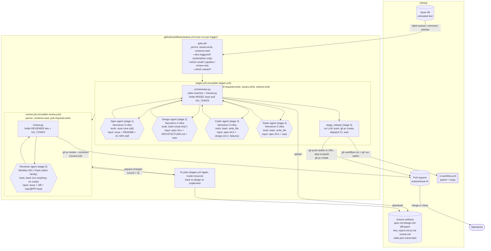

# Component view

Who runs where, which tools and credentials each part holds, and how the parts call each other.
Boxes with a thick border are LLM agents; everything else is deterministic code.
The rule behind the picture: **agents never hold a GitHub token or an API key**. Only the
deterministic orchestrator talks to GitHub and to the model providers.

`*` "read-only" is enforced after the fact: the orchestrator runs `git status` after a
read-only agent and discards any change it made (see ADR-005).

## Agents and their tools

| Agent | Stage | Model (fallback) | Tools | Sees | Never sees |
|---|---|---|---|---|---|
| Spec | 1 | Nemotron-3 Ultra 550B on NIM (same model, free on OpenRouter) | none, one chat call | issue text, `README.rst`, A1 `SKILL.md` | code, other agents |
| Design | 2 | same | `bash` in repo; changes discarded | spec ACs, `ARCHITECTURE.md`, repo | issue text (only via spec) |
| Coder | 3 | same | `bash`, `write_file` | spec ACs, `design.md`, failing test output on retries | tester's reasoning; may not edit tester's test file |
| Tester | 4 | same | `bash`, `write_file` | spec ACs, repo with the change | coder's conversation |
| Release | 5 | none (code) | `git`, `gh` with `GITHUB_TOKEN` | artifacts | n/a |
| Reviewer | 6 | MiniMax M3.1 Flash, thinking off, on NIM (Gemma-4 31B free on OpenRouter) | `bash` in a fresh checkout of the PR head; no credentials | issue text, `git diff main...HEAD`, repo | spec, design, test report, any transcript |

## Credentials

| Secret | Who can read it |
|---|---|
| `NVIDIA_NIM_API_KEY`, `OPENROUTER_API_KEY` | orchestrator / review.py process only. Agent commands run as a separate Unix user `agent` with an empty environment, so they cannot read the parent's `/proc/<pid>/environ`. |
| `GITHUB_TOKEN` | release step and review-posting step only, through `env:` on that step. `actions/checkout` runs with `persist-credentials: false`, so `.git/config` holds no token. |
