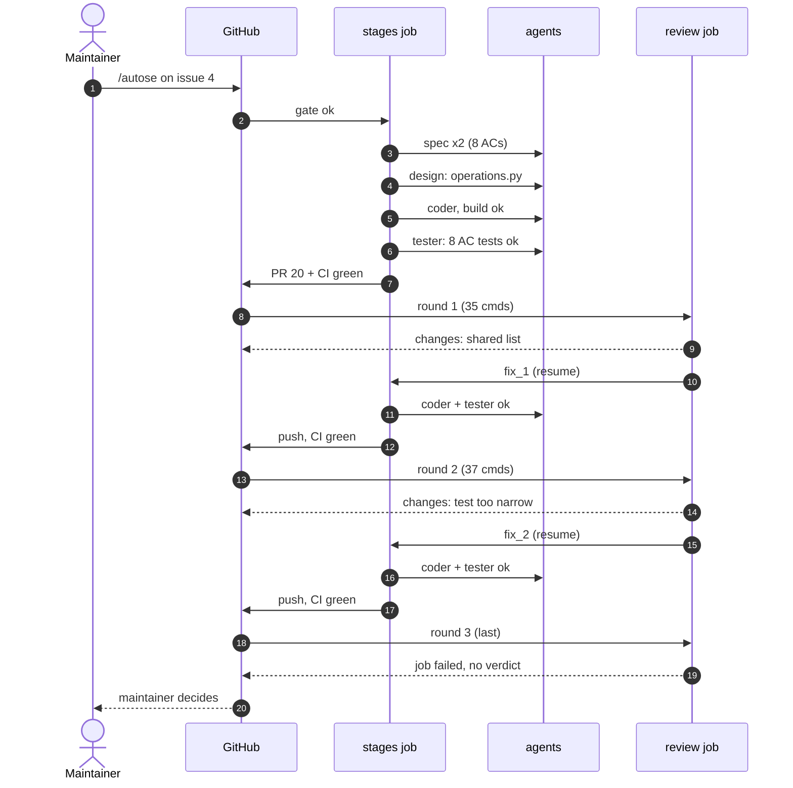

# Sequence view: one real run

Issue #4 ("Add an update operation to append a value to a list field"), run
[45454368595](https://github.com/Harshit-Lalwani/AutoSE-A3-tinydb/actions/runs/45454368595), PR
[#20](https://github.com/Harshit-Lalwani/AutoSE-A3-tinydb/pull/20). Every step below is taken from that run's
job timings, its artifacts (`state.json`, `review.json`) and the review comments on PR #20.

Run 45454368595; each arrow is an Actions job or artifact. Spec: first answer had 3 blocking questions, the retry gave 8 testable ACs. Round 1: `append` mutated a list shared by two documents (reproduced). Round 2: the fail-fast test only holds for MemoryStorage, and the PR contained unrelated files from a workflow bug (fix rounds compared against the newest `main`; fixed in PR #26). Round 3 failed without a verdict because the GitHub runner lost its connection. Builder tokens 2.32 M of 2.5 M; each review has its own 400 k budget.
